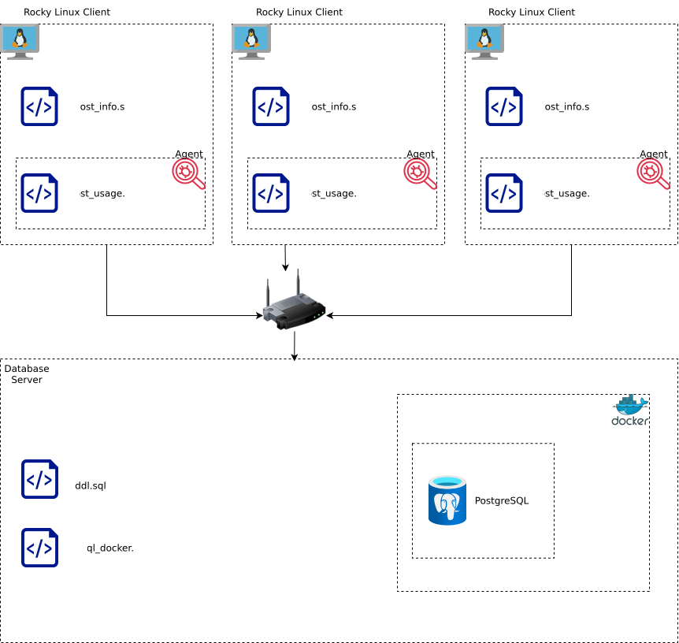

# Linux Cluster Monitoring Agent

# Introduction
This project aims to help the Linux Cluster Administration team make better infrastructure planning decisions. In an environment consisting of 10 or more Linux servers, administrators need to understand which servers are underutilized, which are approaching capacity, and whether additional infrastructure investment is necessary. Without historical resource usage data, making these decisions can be difficult to justify and may lead to unnecessary spending.

The core technologies used which include **Bash scripting** for collecting host information and host usage, **Docker** for provisioning the PostgreSQL instance, **PostgreSQL** for storing host information and host usage, **Git** for version control and **crontab** for scheduling host usage every minute.

# Quick Start
1. Start a psql instance using psql_docker.sh
```
./scripts/psql_docker.sh start|stop|create [db_username] [db_password]
```
2. Create tables using ddl.sql with database name host_agent
```
psql -h psql_host -U psql_username -d host_agent -W -f sql/ddl.sql
```
3. Insert hardware specs data into the database using host_info.sh
```
./scripts/host_info.sh psql_host psql_port db_name psql_username psql_password
```
4. Insert hardware usage data into the database using host_info.sh
```
./scripts/host_usage.sh psql_host psql_port db_name psql_username psql_password
```
5. Crontab setup
```
Bash > crontab -e

#Minute Hour Day of Month Month Day of Week
* * * * * bash /path/to/scripts/host_usage.sh psql_host psql_port host_agent psql_username psql_password > /tmp/host_usage_$(date + \%Y-\%m-\%d_\%H-\%M).log 2&>1
```

# Implementation
## Architecture


## Scripts
### psql_docker.sh
Manages the lifecycle of the PostgreSQL Docker container. Three supported operations are: create a psql docker container with the given username and password, start the stopped psql docker container, and stop the running psql docker container.
```
# examples
# create a psql docker container with the given username and password.
./scripts/psql_docker.sh create db_username db_password

# start the stoped psql docker container
./scripts/psql_docker.sh start

# stop the running psql docker container
./scripts/psql_docker.sh stop
```

### host_info.sh
This shell script collects hardware specifications from the current host, including the number of CPUs, CPU architecture, CPU model, CPU frequency, and total memory, and inserts the information into the `host_info` table. Run this script once whenever a new host is introduced.
```
./scripts/host_info.sh psql_host psql_port db_name psql_username psql_password
```

### host_usage.sh
This shell script collects system usage metrics from the current host, including CPU idle count, free memory, CPU kernel usage, CPU model, disk I/O, and available disk space, and inserts the data into the `host_usage` table. The script is scheduled to run every minute using Linux's `crontab`.
```
./scripts/host_usage.sh psql_host psql_port db_name psql_username psql_password
```

### crontab
Use Linux's `crontab` to execute `host_usage.sh` every minute. The five fields in the cron expression represent, in order, Minute, Hour, Day of Month, Month, and Day of Week. Script output and error messages are logged to `/tmp/host_usage_$(date +\%Y-\%m-\%d_\%H-\%M).log`.
```
Bash > crontab -e

* * * * * bash /path/to/scripts/host_usage.sh psql_host psql_port host_agent psql_username psql_password > /tmp/host_usage_$(date + \%Y-\%m-\%d_\%H-\%M).log 2&>1
```


## Database Modeling
### host_info
Stores specifications for each node.

|      Column      |    Data Type    |    Description    |
| :--------------- | :-------------: |:-----------------:|
|       id         |      SERIAL     | Auto-incrementing primary key     |
|    host_name     |     VARCHAR     | Host name|
|    cpu_number    |      INT2       |     Number of CPU cores         |
| cpu_architecture |    VARCHAR      |     CPU Architecture (e.g. x86, ARM ...)         |
|    cpu_model     |    VARCHAR      |      Name of the CPU Model       |
|     cpu_mhz      |     FLOAT8      |      CPU clock speed in MHz        |
|     l2_cache     |     INT4        |      L2 cache size in KB        |
|    timestamp     |    TIMESTAMP    |       Time inserted       |
|    total_mem     |     INT4        |        Total memory in KB      |

### host_usage
Stores system usage metrics.

|      Column      |    Data Type    |    Description    |
| :--------------- | :-------------: |:-----------------:|
|   timestamp      |   TIMESTAMP     | Time inserted    |
|    host_id       |     SERIAL      | Foreign key referencing `host_info.id`|
|    memory_free   |      INT4       |     Available free RAM in MB         |
|    cpu_idle      |      INT2       |     Percentage of total CPU time spent completely idle since boot          |
|    cpu_kernel    |      INT2       |     Percentage of total CPU time spent running kernel-level code      |
|     disk_io      |      INT4       |      Disk I/O time in second        |
|   disk_available |      INT4       |      Available disk space in MB      |


# Test
Tested `psql_docker.sh` to start the PostgreSQL Docker container and execute `ddl.sql` to create the required database tables. Verified that the container could also be stopped and restarted using `./scripts/psql_docker.sh stop [db_username] [db_password]` and `./scripts/psql_docker.sh start [db_username] [db_password]`. Verified that `host_info.sh` successfully collected and inserted hardware information into `host_info`, and that `host_usage.sh` collected and inserted system usage metrics into `host_usage`.

Configured `crontab` to execute `host_usage.sh` every minute. Verified that new usage records were periodically inserted into the database and checked the log files to ensure there were no execution errors.

# Deployment
- **GitHub:** Followed the Gitflow workflow by creating a separate feature branch for each feature, merging completed features into `develop`, and creating a pull request to merge `develop` into `main`.
- **Docker:** Used Docker to deploy a PostgreSQL database container based on the Alpine image.
- **Crontab:** Configured a cron job to execute `host_usage.sh` every minute to periodically collect and store system usage metrics.

# Improvements
- Replace hardcoded column indexes when parsing system command outputs with named variables or header-based parsing to improve maintainability.
- Move database credentials and connection settings into environment variables or a configuration file.
- Implement log rotation to prevent log files from growing indefinitely. Retain a limited number of historical logs and compress older files to reduce disk usage.
- Improve error handling for database connection failures, missing dependencies, and unsuccessful SQL execution.
- Prevent duplicate host records by enforcing hostname uniqueness and using an appropriate insert strategy.